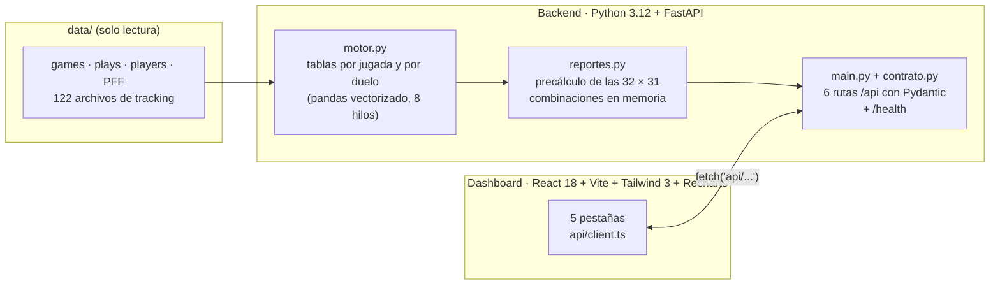

# Queryback · Hoja de Protección

> Cuánto tiempo tiene tu QB antes de la presión, por dónde llega y qué hacer al respecto.
> Proyecto del **Hackathon NFL Big Data Bowl · UNAM 2026**.


**Hoja de Protección** es una herramienta para el **coordinador ofensivo**. Elige su equipo y el rival, y en unos segundos ve:

1. **Cuánto tiempo tiene su QB** antes de que llegue la presión de esa defensa (el *tiempo seguro*).
2. **Por dónde llega la presión** (izquierda, centro o derecha) y quién es la amenaza principal.
3. **3 acciones concretas** para el partido, cada una con su número y su comparación contra la liga.

Ejemplo real (captura de arriba): **TB vs CLE**. Contra Cleveland, el QB tiene **2.4 s** (liga 2.7 s), y Tom Brady suelta
el balón en 2.6 s, **0.2 s tarde**. El **47%** de la presión llega por su izquierda, donde **Myles Garrett** gana el **18.2%**
de sus duelos (liga 6.7%). Cleveland presiona en el 42% de las jugadas (liga 32%) y en el 50% de los terceros downs (liga 39%).

Todo sale de **8,533 jugadas** de tracking de la NFL. Nuestra marca de presión, calculada solo con posiciones, coincide con la de PFF en el **82.4%** de las jugadas.

---

## Contenido

- [Datos](#datos)
- [Las 5 pestañas](#las-5-pestañas)
- [Metodología](#metodología)
- [Arquitectura](#arquitectura)
- [API](#api)
- [Cómo correrlo](#cómo-correrlo)
- [Validación](#validación)
- [Estructura del repositorio](#estructura-del-repositorio)
- [Cómo se construyó](#cómo-se-construyó)
- [Limitaciones y siguientes pasos](#limitaciones-y-siguientes-pasos)
- [Equipo y créditos](#equipo-y-créditos)

---

## Datos

Usamos el dataset oficial del evento:
[**ThompsonJamesBliss/nfl-big-data-bowl-regional-event-data**](https://github.com/ThompsonJamesBliss/nfl-big-data-bowl-regional-event-data).
Es el formato del NFL Big Data Bowl 2023 (protección y presión al pasador). El tracking viene de **NFL Next Gen Stats** y el scouting de **Pro Football Focus (PFF)**.

| Archivo | Contenido | Llave | Tamaño |
|---|---|---|---|
| `games.csv` | 122 partidos, temporada 2021, semanas 1 a 8 | `gameId` | 7 KB |
| `plays.csv` | 8,557 jugadas de pase, 32 equipos (down, distancia, play action, cobertura, resultado) | `gameId`, `playId` | 2.3 MB |
| `players.csv` | 1,679 jugadores (nombre, posición) | `nflId` | 0.1 MB |
| `pffScoutingData.csv` | 188,254 filas jugador-jugada: rol, posición, hit / hurry / sack, a quién bloqueó | `gameId`, `playId`, `nflId` | 13 MB |
| `tracking/tracking_[gameId].csv` | 122 archivos, posición `x`, `y` de cada jugador cada 0.1 s, más los eventos (`ball_snap`, `pass_forward`, `qb_sack`…) | `gameId`, `playId`, `nflId`, `frameId` | ~850 MB |

Columnas que usa el motor:

- **Tracking:** `gameId, playId, nflId, frameId, x, y, event, playDirection`. Solo esas, con tipos compactos (`int16`, `float32`, `category`).
- **PFF:** `pff_role` (QB = `Pass`, rusher = `Pass Rush`, bloqueador = `Pass Block`), `pff_positionLinedUp`, `pff_hit`, `pff_hurry`, `pff_sack`, `pff_hitAllowed`, `pff_hurryAllowed`, `pff_sackAllowed`, `pff_nflIdBlockedPlayer`.
- **Plays:** `down, yardsToGo, possessionTeam, defensiveTeam, passResult, prePenaltyPlayResult, dropBackType, pff_playAction, pff_passCoverageType`.

La carpeta `data/` **no se versiona** (`.gitignore`). Ver [Cómo correrlo](#cómo-correrlo) para descargarla.

---

## Las 5 pestañas

Están ordenadas por prioridad de uso en la semana de preparación:

| Pestaña | Pregunta que responde | Qué muestra |
|---|---|---|
| **Partido** | ¿Cuánto tiempo tengo contra este rival? | Tiempo seguro del rival vs liga, con semáforo rojo / amarillo / verde. Tiempo de lanzamiento de mi QB y diferencia. Reparto de la presión por lado, amenaza #1 y el bloqueador mío que la enfrenta. 3 claves del partido. Contexto: presión, 3er down y blitz contra la liga. |
| **Situación** | ¿Qué espero en este down y distancia? | Presión y blitz del rival en 1º-2º, 3º corto, 3º medio y 3º largo, con la acción recomendada. Si el rival tiene menos de 20 jugadas en la situación, usa la liga y lo marca. |
| **Cambiar jugada** | ¿Qué pasa si uso play action, rollout o más bloqueadores? | Presión esperada y yardas de diferencia, estimadas con jugadas parecidas de toda la liga. |
| **Sin su estrella** | ¿Cuánto depende su pass rush de un solo jugador? | Tiempo seguro y % de presión con y sin la amenaza #1 en el campo. |
| **Repetición** | ¿Cómo se ve en el campo? | Animación de una jugada real en la que la amenaza #1 llega en 2.2 a 2.8 s (prefiere un sack). |

Los equipos y la pestaña viven en la URL (`?ofensiva=TB&rival=CLE&vista=partido`), así que una vista se puede compartir.

---

## Metodología

Las definiciones están fijadas en [`.kiro/steering/equipo.md`](.kiro/steering/equipo.md) y el código las sigue tal cual.

### Ventana de la jugada
- **Inicio** = primer frame con evento `ball_snap` o `autoevent_ballsnap`.
- **Fin** = primer frame con `pass_forward`, `autoevent_passforward`, `qb_sack`, `qb_strip_sack`, `run` o `fumble`.
- Se excluyen jugadas sin Inicio o sin Fin. **Lanzamiento (s) = (Fin − Inicio) / 10.**

### Presión, reloj y lado
- **Presión** = primer frame entre Inicio + 5 y Fin en que un rusher está a **≤ 2.0 yd** del QB.
- **Reloj (s)** = (frame de presión − Inicio) / 10.
- **Lado** (desde la vista del QB): `dy = y_rusher − y_qb`, invertido si `playDirection == "left"`. `dy > 1` es izquierda, `dy < −1` es derecha, y lo demás es centro.

### Tiempo seguro
El **tiempo seguro** de una defensa es el primer `t` (en pasos de 0.1 s) en que el **15%** de sus jugadas ya tiene presión (Reloj ≤ t).
Es un percentil 15 del reloj de presión sobre *todas* sus jugadas, incluidas las que no tuvieron presión.

**Semáforo:** rojo si el tiempo seguro es menor que la liga − 0.15 s, verde si es mayor que la liga + 0.15 s, amarillo en otro caso.

### Duelos y amenaza #1
- **Duelo** = fila PFF `Pass Block` con `pff_nflIdBlockedPlayer`. Se pierde si el bloqueador permitió hurry, hit o sack.
- **gana_pct** del defensor (mínimo 100 duelos) y **pierde_pct** del bloqueador.
- **Amenaza #1** = el rusher que más veces llega primero. Su lado es la moda de sus lados.
- **Mi bloqueador del lado:** izquierda → LT, derecha → RT, centro → el que más pierde entre LG, C y RG. El titular de cada posición es el que tiene más jugadas en ella.
- **Mi QB** = el QB con más jugadas del equipo. Su lanzamiento es la **mediana** de sus jugadas, para que un scramble de 7 s no la infle.

### Claves del partido
Cada candidata recibe un puntaje basado en `z = (valor − promedio de las 32 defensas) / desviación estándar`.
Se quedan las de puntaje > 0.3, ordenadas de mayor a menor, máximo 3:

| # | Clave | Puntaje | Condición |
|---|---|---|---|
| 1 | Suelta antes de {ts} s | −z(ts) + max(0, lanzamiento_QB − ts) / 0.3 | siempre |
| 2 | Ayuda extra contra {amenaza} | z(gana_pct) + (pierde_pct de mi bloqueador − 6) / 3 | hay gana_pct |
| 3 | Usa play action en 1º y 2º | z(yardas con PA − sin PA) | delta ≥ 0.5 yd y ≥ 20 jugadas PA |
| 4 | En 3er down, suelta en menos de 2 s | z(presión en 3er down) | mayor que la liga |
| 5 | Si mandan blitz, pase rápido | z(blitz %) | ≥ liga |
| 6 | Rutas que se separen rápido | z(100 − zona %) | ≥ 40% |
| 7 | Mueve al QB a la {lado débil} | z(% del lado más fuerte) | ≥ 40% |
| 8 | Hay tiempo: busca el pase largo | (ts − ts_liga) / desviación | ts > liga |

### Situaciones y escenarios
- **Situaciones:** `a` = 1º y 2º down, `c` = 3º y 1-3, `m` = 3º y 4-6, `l` = 3º o 4º y 7+. Si la presión supera la de la liga por 8 puntos o más, la recomendación es soltar en menos de 2 s. Si queda 8 o más por debajo, hay tiempo. Si el blitz supera la liga por 10 puntos o más, avisa de lectura rápida.
- **Cambiar jugada:** multiplicador de presión y diferencia de yardas de cada opción contra su base, medidos en toda la liga (play action vs no; `DESIGNED_ROLLOUT_*` vs `TRADITIONAL`; 6 o 7 bloqueadores vs 5). `presión esperada = presión del rival × producto de multiplicadores`.

### Qué no calculamos
Nada después del lanzamiento: destino del balón, receptores ni yardas aéreas. Los textos dicen "se asocia con", nunca "causa".

---

## Arquitectura



- **Carga única:** al arrancar (`lifespan` de FastAPI), `motor.cargar()` lee el tracking archivo por archivo en un `ThreadPoolExecutor`, recorta cada jugada a la ventana [Inicio, Fin] y calcula presión, reloj, lado y presionador con merges, sin bucles por jugada.
- **Caché:** `reportes.cargar()` precalcula las respuestas de las 992 parejas ofensiva-rival y de todos los escenarios y situaciones. Cada ruta solo copia un dict de la caché, así que responde en milisegundos.
- **Una sola URL:** si existe `dashboard/dist`, FastAPI sirve el build en `/`, junto a la API y `/health`.
- **Sin escritura a disco** y sin llaves en el código: el servidor puede ser efímero.
- **Contrato en tres capas** que deben coincidir: `equipo.md` (definición), `backend/contrato.py` (Pydantic) y `dashboard/src/api/types.ts` (TypeScript). `backend/verificar_contrato.py` compara las dos últimas campo por campo.

---

## API

Todas las rutas son `GET`. Los porcentajes son enteros de 0 a 100 y los segundos llevan 1 decimal. La documentación interactiva queda en `http://localhost:8000/docs`.

| Ruta | Parámetros | Devuelve |
|---|---|---|
| `/health` | | `{"status": "ok"}` |
| `api/opciones` | | equipos disponibles y `validacion_pct` (acuerdo con PFF) |
| `api/partido` | `ofensiva`, `rival` | tiempo seguro, nivel, QB, lados, amenaza, bloqueador, claves, contexto |
| `api/situacion` | `rival`, `sit` = `a` \| `c` \| `m` \| `l` | presión y blitz vs liga, fuente, acción, detalle, nivel |
| `api/escenario` | `rival`, `pa` = 0\|1, `rollout` = 0\|1, `bloqueadores` = 5\|6\|7 | presión actual, presión esperada, yardas delta |
| `api/estrella` | `rival` | tiempo seguro, presión y n con y sin la amenaza #1 |
| `api/repeticion` | `rival` | descripción, reloj, fin y frames (`Q` QB, `R` rusher, `B` bloqueador, `E` estrella) |

Errores: un equipo inexistente da **404**, `ofensiva == rival` da **400** y un parámetro inválido da **400** (no 422).

```bash
curl "http://localhost:8000/api/partido?ofensiva=TB&rival=CLE"
```

---

## Cómo correrlo

El entorno es aislado: `setup` instala uv, Python 3.12.12, Node 22 y las dependencias **dentro** de la carpeta del proyecto, sin tocar lo que tengas instalado. Detalles en [`.hackathon/INSTALACION.md`](.hackathon/INSTALACION.md).

### 1. Instalar el entorno

```powershell
# Windows
.\.hackathon\setup.cmd --check
```
```bash
# macOS / Linux
sh .hackathon/setup.sh --check
```

### 2. Descargar los datos

```bash
git clone --depth 1 https://github.com/ThompsonJamesBliss/nfl-big-data-bowl-regional-event-data.git ../nfl-datos
# Copia (o mueve) la carpeta data/ a la raíz de este proyecto:
#   Windows:      xcopy /E /I ..\nfl-datos\data data
#   macOS/Linux:  cp -r ../nfl-datos/data ./data
```

Debe quedar `data/games.csv`, `data/plays.csv`, `data/players.csv`, `data/pffScoutingData.csv` y `data/tracking/tracking_*.csv` (122 archivos, ~830 MB en total).

### 3. Backend (puerto 8000)

```powershell
.\.venv\Scripts\python.exe -m uvicorn backend.main:app --port 8000
# o doble clic en start_backend.cmd
```
Al arrancar lee todo el tracking una vez (puede tardar según la máquina) e imprime el progreso (`[motor] tracking 20/122 ...`) y al final `[reportes] Caché lista`.

### 4. Dashboard en desarrollo (puerto 5173)

```powershell
.\.hackathon\.tools\node\npm.cmd --prefix dashboard run dev
# o doble clic en start_dashboard.cmd
```
Abre `http://localhost:5173`. Vite reenvía `/api` al puerto 8000.

### 5. Todo en una sola URL

```powershell
.\.hackathon\.tools\node\npm.cmd --prefix dashboard run build
.\.venv\Scripts\python.exe -m uvicorn backend.main:app --port 8000
```
Abre `http://localhost:8000/?ofensiva=TB&rival=CLE`.

> Para trabajar el frontend sin backend ni datos, pon `USE_MOCK = true` en `dashboard/src/api/client.ts`.

### 6. Entrega

```powershell
.\.hackathon\setup.cmd --entregar
```
Valida el stack, revisa este README, compila el dashboard y genera el `.zip` de entrega.

---

## Validación

### Contra PFF
Para cada jugada comparamos nuestra presión (solo con tracking) con la de PFF (algún rusher con `pff_hit`, `pff_hurry` o `pff_sack` = 1). Coinciden en el **82.4%** de las jugadas, y el dato se muestra en el pie del dashboard.

### Valores de control
`python -m backend.reportes` imprime cada valor calculado junto al esperado:

| Valor | Esperado |
|---|---|
| Jugadas con Inicio y Fin | ~8,530 |
| Presión de la liga | 32% |
| Tiempo seguro de la liga | 2.7 s |
| Acuerdo con PFF | ~82% |
| CLE: tiempo seguro | 2.4 s |
| CLE: amenaza #1 | Myles Garrett, gana ~18%, por la izquierda (lo enfrenta el LT) |
| NO: tiempo seguro | 3.1 s |
| CLE con Garrett / sin Garrett | 2.4 s y 45% / 2.9 s y 29% |
| Liga: presión en 1º-2º / 3º largo | ~28% / ~45% |
| CLE: presión en 3º largo | ~60% |

### Scripts de prueba

```powershell
.\.venv\Scripts\python.exe -m backend.reportes            # valores de control y partido TB vs CLE
.\.venv\Scripts\python.exe -m backend.verificar_contrato  # contrato.py == types.ts
.\.venv\Scripts\python.exe -m backend.probar_api          # con el servidor arriba: 6 rutas, errores y tiempos
```

---

## Estructura del repositorio

```
backend/
  motor.py               lectura de CSV y tablas por jugada / duelo / rol (pandas, vectorizado)
  reportes.py            métricas, claves y precálculo en caché
  contrato.py            modelos Pydantic de cada respuesta
  main.py                FastAPI: /health, 6 rutas /api y build del dashboard
  verificar_contrato.py  compara contrato.py con dashboard/src/api/types.ts
  probar_api.py          prueba manual de la API en vivo
dashboard/src/
  api/                   client.ts (fetch y errores), types.ts (contrato), mock.ts
  features/              partido · situacion · cambiar · estrella · repeticion
  components/            gráficas (Recharts) y componentes de UI
  lib/                   formato, semáforo y hook de carga de datos
.kiro/steering/          reglas, definiciones y guías por agente (data, backend, frontend)
prompts/                 los 4 prompts usados para construir el proyecto con Kiro
.hackathon/              instalador y validador del stack del evento (no editar)
data/                    dataset (no versionado)
```

Stack (fijo por el evento): Python 3.12.12, FastAPI 0.115.14, Uvicorn 0.34.3, Pydantic 2.11.7, pandas 2.2.3, NumPy 2.1.3, React 18.3.1, TypeScript 5.7.3, Vite 5.4.21, Tailwind CSS 3.4.19 y Recharts 3.10.1.

---

## Cómo se construyó

Construimos el proyecto con **Kiro**, con un agente por capa y un contrato compartido. Los archivos de [`.kiro/steering/`](.kiro/steering) fijan las definiciones, y cada agente solo edita los archivos que le tocan:

| Fase | Qué se hizo |
|---|---|
| 0 | Steering (`equipo.md`, `data.md`, `backend.md`, `frontend.md`) y prompts en `prompts/` |
| 1 | Agente Data ([`prompts/A_data.md`](prompts/A_data.md)): `motor.py` y `reportes.py`, hasta que los valores de control salieron bien |
| 2 | Agente Backend ([`prompts/C_backend.md`](prompts/C_backend.md)): contrato Pydantic, 6 rutas con `lifespan`, errores 404 / 400 |
| 3 | Agente Frontend ([`prompts/B_frontend.md`](prompts/B_frontend.md)): las 5 pestañas, primero con mock y luego con el backend real |
| 4 | Integración ([`prompts/D_integracion.md`](prompts/D_integracion.md)): revisión contra las reglas del evento y `verificar_contrato.py` |

El historial original está en [OctavioSalgado-Ing/nfl-unam-2026](https://github.com/OctavioSalgado-Ing/nfl-unam-2026).

---

## Limitaciones y siguientes pasos

- **Muestra:** son 8 semanas de 2021. Algunos rivales tienen pocas jugadas en ciertas situaciones. Debajo de 20 jugadas usamos la liga y lo marcamos como `fuente: "liga"`.
- **Presión geométrica:** "a ≤ 2 yd del QB" no distingue un rusher que pasa cerca de uno que de verdad obliga a soltar. Por eso no coincide con PFF en ~18% de las jugadas.
- **Asociación, no causa:** "Cambiar jugada" compara jugadas parecidas de toda la liga. No controla down, distancia ni calidad del rival.
- **Sin su estrella** compara jugadas en que la estrella fue rusher contra jugadas en que no lo fue. Esas jugadas también difieren en otras cosas, como el down o el marcador.
- **Ideas para seguir:**
  - usar la velocidad y orientación (`s`, `dir`) para una presión "en camino" más fina;
  - agregar intervalos de confianza al tiempo seguro;
  - controlar por down y distancia en los escenarios;
  - cruzar con el play-by-play de [nflverse](https://nflverse.nflverse.com/) (`old_game_id`, `play_id`) para medir EPA.

---

## Equipo y créditos

- **Octavio Salgado** y **Diego Varela Jiménez**. Trabajo realizado durante el hackathon NFL Big Data Bowl · UNAM 2026, solo por los participantes.
- Datos: NFL Next Gen Stats y Pro Football Focus, vía [nfl-big-data-bowl-regional-event-data](https://github.com/ThompsonJamesBliss/nfl-big-data-bowl-regional-event-data).
