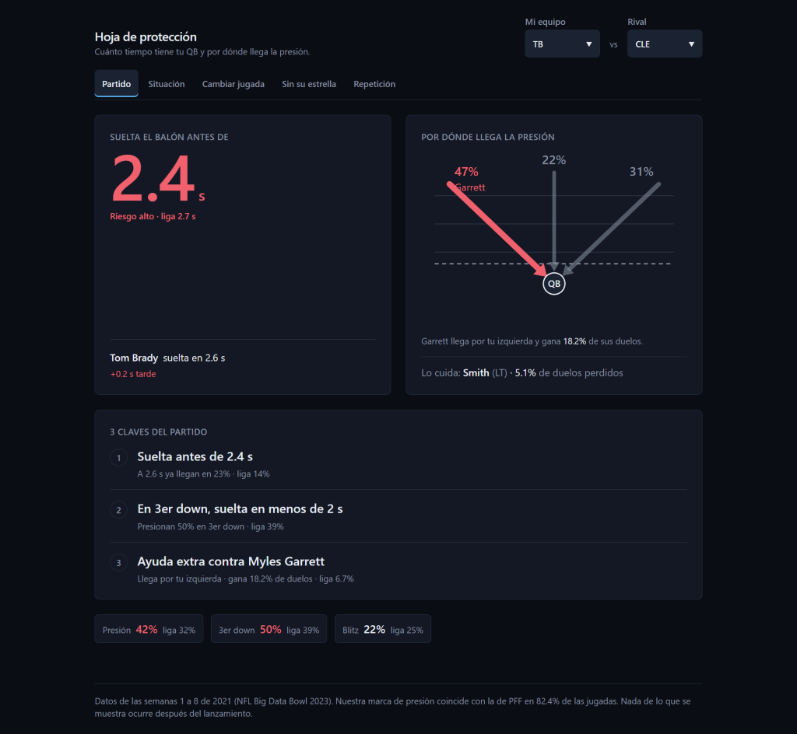
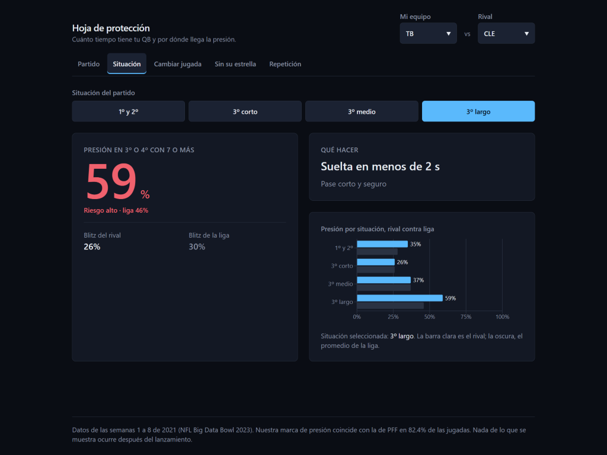
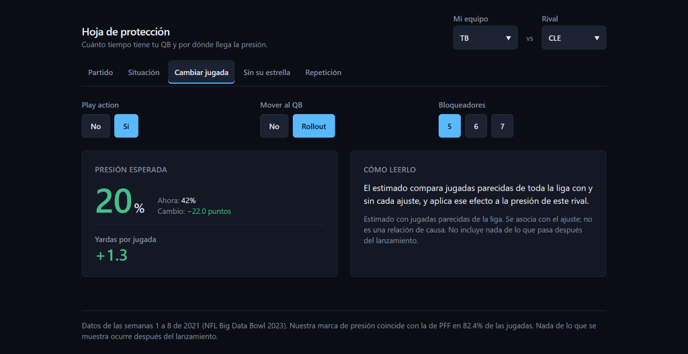
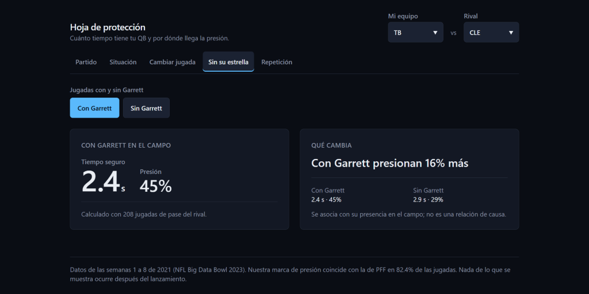
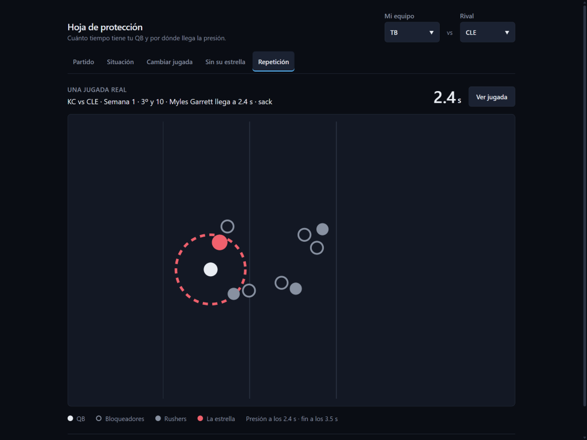
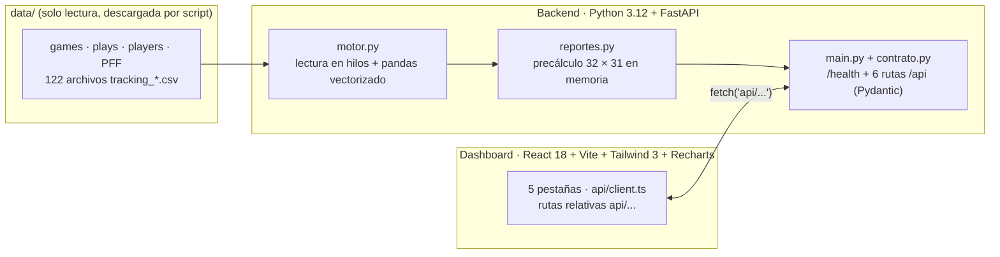

# Queryback · Hoja de Protección

[](https://github.com/DiegoV-J/Queryback/actions/workflows/ci.yml)

> Cuánto tiempo tiene tu QB antes de la presión, por dónde llega y qué hacer al respecto.  
> Proyecto del **Hackathon NFL Big Data Bowl · UNAM 2026**.



**Hoja de Protección** es una plataforma analítica para el **coordinador ofensivo** y entrenadores de quarterbacks. Elige tu equipo y el rival de turno para responder en menos de 5 segundos:

1. **Cuánto tiempo seguro tiene tu QB** antes de que llegue la presión defensiva (comparado contra el promedio de la liga).
2. **Por dónde llega la presión** (izquierda, centro o derecha desde la perspectiva del QB), quién es la amenaza #1 y qué liniero ofensivo titular la enfrenta.
3. **3 acciones concretas** para el plan de partido, priorizadas estadísticamente con z-scores y respaldadas con cifras comparativas contra toda la NFL.

Ejemplo real (captura superior): **TB vs CLE**. Contra Cleveland, el QB dispone de **2.4 s** (liga **2.7 s**), mientras Tom Brady suelta el balón en **2.6 s** (**+0.2 s tarde**). El **47%** de la presión de CLE llega por la izquierda del QB, donde **Myles Garrett** gana el **18.2%** de sus duelos (liga **6.7%**). Cleveland presiona en el **42%** de las jugadas (liga **32%**) y en el **50%** de los terceros downs (liga **39%**).

Todo se calcula a partir de **8,533 jugadas válidas** de tracking de la NFL. Nuestra detección geométrica de presión (basada únicamente en coordenadas) coincide en el **82.4%** de las jugadas con las etiquetas manuales de Pro Football Focus (PFF).

---

## Contenido

- [Dataset original y diccionario de datos](#dataset-original-y-diccionario-de-datos)
- [Las 5 pestañas del dashboard](#las-5-pestañas-del-dashboard)
- [Metodología analítica](#metodología-analítica)
- [Arquitectura y contrato de 3 capas](#arquitectura-y-contrato-de-3-capas)
- [API HTTP](#api-http)
- [Trabajar 100% en la nube (sin entorno local)](#trabajar-100-en-la-nube-sin-entorno-local)
- [Cómo ejecutarlo localmente (entorno aislado)](#cómo-ejecutarlo-localmente-entorno-aislado)
- [Validación y pruebas automatizadas](#validación-y-pruebas-automatizadas)
- [Estructura del repositorio](#estructura-del-repositorio)
- [Cómo se construyó y mejoras en Queryback](#cómo-se-construyó-y-mejoras-en-queryback)
- [Limitaciones y siguientes pasos](#limitaciones-y-siguientes-pasos)
- [Equipo y créditos](#equipo-y-créditos)

---

## Dataset original y diccionario de datos

El análisis consume íntegramente el dataset oficial del evento:  
[**ThompsonJamesBliss/nfl-big-data-bowl-regional-event-data**](https://github.com/ThompsonJamesBliss/nfl-big-data-bowl-regional-event-data) (formato **NFL Big Data Bowl 2023**, centrado en protección de pase y *pass rush*).

- **Tracking posicional:** **NFL Next Gen Stats** (muestreo a **10 Hz**, 1 frame cada `0.1 s`, coordenadas en yardas `x ∈ [0, 120]`, `y ∈ [0, 53.3]`).
- **Scouting por jugador y jugada:** **Pro Football Focus (PFF)**.
- **Cobertura temporal:** semanas **1 a 8** de la temporada **2021** de la NFL (**122 partidos**, **32 equipos**).

### Archivos fuente

| Archivo | Contenido | Llave primaria | Tamaño aprox. |
|---|---|---|---|
| `games.csv` | 122 partidos (temporada, semana, fecha, local y visitante) | `gameId` | ~7 KB |
| `plays.csv` | 8,557 jugadas de pase de los 32 equipos (down, distancia, play action, cobertura, resultado) | `gameId`, `playId` | ~2.3 MB |
| `players.csv` | 1,679 jugadores (nombre completo y posición) | `nflId` | ~104 KB |
| `pffScoutingData.csv` | 188,254 registros jugador-jugada (rol, alineación, `hit`/`hurry`/`sack`, jugador bloqueado) | `gameId`, `playId`, `nflId` | ~13 MB |
| `tracking/tracking_[gameId].csv` | 122 archivos (uno por partido) con `x`, `y`, `event` y `playDirection` cada `0.1 s` | `gameId`, `playId`, `nflId`, `frameId` | ~850 MB |

### Columnas y eventos consumidos por `backend/motor.py`

Para mantener el arranque rápido y bajo uso de memoria, el motor lee únicamente las columnas necesarias con tipos compactos (`int32`, `int16`, `int8`, `float32`, `category`):

- **`tracking_*.csv`:**
  - Columnas: `gameId`, `playId`, `nflId`, `frameId`, `x`, `y`, `event`, `playDirection` (los valores `"NA"` y `"None"` se tratan como nulos).
  - Eventos de inicio (`EVENTOS_INICIO`): `ball_snap`, `autoevent_ballsnap`.
  - Eventos de fin (`EVENTOS_FIN`): `pass_forward`, `autoevent_passforward`, `qb_sack`, `qb_strip_sack`, `run`, `fumble`.
- **`pffScoutingData.csv`:**
  - `pff_role`: mapeado a `Q` (`Pass`), `R` (`Pass Rush`) y `B` (`Pass Block`).
  - `pff_positionLinedUp`: identifica titulares de línea ofensiva (`LT`, `LG`, `C`, `RG`, `RT`).
  - Presión PFF y duelos: `pff_hit`, `pff_hurry`, `pff_sack`, `pff_hitAllowed`, `pff_hurryAllowed`, `pff_sackAllowed`, `pff_nflIdBlockedPlayer`.
- **`plays.csv`, `games.csv`, `players.csv`:**
  - `down`, `yardsToGo`, `possessionTeam`, `defensiveTeam`, `passResult`, `prePenaltyPlayResult`, `dropBackType`, `pff_playAction`, `pff_passCoverageType`, `week`, `displayName`.

> La carpeta `data/` **no se versiona en Git** (excluida en `.gitignore` por el peso total de ~850 MB). Para descargarla y validarla automáticamente en cualquier entorno ejecuta:
> ```bash
> python scripts/descargar_datos.py
> ```

---

## Las 5 pestañas del dashboard

Las vistas están ordenadas por prioridad táctica durante la semana de preparación:

| Pestaña | Pregunta que responde | Qué muestra |
|---|---|---|
| **Partido** | ¿Cuánto tiempo tengo contra este rival? | Tiempo seguro del rival vs liga con semáforo (rojo / amarillo / verde), mediana de lanzamiento de tu QB y diferencia, reparto de presión por carril en `CampoMini`, amenaza #1 y bloqueador titular que la enfrenta, top 3 claves y píldoras de contexto (presión, 3er down, blitz). |
| **Situación** | ¿Qué esperar según down y distancia? | Presión y blitz en 1º-2º, 3º corto (`1-3 yd`), 3º medio (`4-6 yd`) y 3º largo (`7+ yd`), gráfica comparativa con Recharts y recomendación táctica. Si el rival tiene `< 20` jugadas en la situación, usa la liga y muestra `fuente: "liga"`. |
| **Cambiar jugada** | ¿Qué pasa si ajusto la protección o el diseño? | Simulador combinatorio de *play action*, *rollout* y número de bloqueadores (`5`, `6` o `7`) mostrando presión esperada y diferencia de yardas estimadas a nivel liga. |
| **Sin su estrella** | ¿Cuánto depende el *pass rush* de un solo jugador? | Compara tiempo seguro, % de presión y tamaño de muestra (`n`) cuando la amenaza #1 está como rusher vs cuando no participa (mínimo 20 jugadas por grupo). |
| **Repetición** | ¿Cómo se ve la presión en el campo? | Animación SVG fluida (`requestAnimationFrame`) de una jugada real donde la amenaza #1 llega entre `2.2` y `2.8 s` (prioriza *sack*), mostrando el anillo de `2.0 yd` alrededor del QB. |

Los selectores y la pestaña activa se sincronizan con la URL (`?ofensiva=TB&rival=CLE&vista=partido`) para compartir reportes directamente y conservar estado al recargar.

<details>
<summary>Ver capturas limpias de las otras 4 pestañas (TB vs CLE con datos reales)</summary>

| Situación (`3º largo`: 59%) | Cambiar jugada (`Play action` + `Rollout`) |
|---|---|
|  |  |

| Sin su estrella (`Con Garrett` vs `Sin Garrett`) | Repetición (`Sack` a los `2.4 s`) |
|---|---|
|  |  |

</details>

---

## Metodología analítica

Todas las definiciones viven como fuente única de verdad en [`.kiro/steering/equipo.md`](.kiro/steering/equipo.md):

### 1. Ventana de jugada y lanzamiento
- **Inicio:** primer frame con `ball_snap` o `autoevent_ballsnap`.
- **Fin:** primer frame con `pass_forward`, `autoevent_passforward`, `qb_sack`, `qb_strip_sack`, `run` o `fumble`.
- Se descartan jugadas sin Inicio o sin Fin (o con `Fin <= Inicio`). **Lanzamiento (s)** = `(Fin − Inicio) / 10`.
- El lanzamiento del QB titular de cada ofensiva se resume con la **mediana** para evitar distorsiones por *scrambles* largos.

### 2. Presión geométrica, reloj y lado
- **Presión:** primer frame en `[Inicio + 5, Fin]` donde al menos un `Pass Rush` está a distancia euclidiana `<= 2.0 yd` del QB (`Pass`).
- **Reloj (s):** `(frame_presion − Inicio) / 10`.
- **Lado (vista del QB):** `dy = y_rusher − y_qb`, invertido (`-dy`) cuando `playDirection == "left"`. `dy > 1.0` → `izquierda`; `dy < -1.0` → `derecha`; en otro caso → `centro`.

### 3. Tiempo seguro y semáforo
- **Tiempo seguro:** primer instante `t` (en múltiplos de `0.1 s`) donde el **15%** acumulado de todas las jugadas de la defensa (incluidas las sin presión) ya registró presión (`Reloj <= t`).
- **Semáforo:** `rojo` si `ts < ts_liga − 0.15 s`, `verde` si `ts > ts_liga + 0.15 s`, `amarillo` en otro caso.

### 4. Duelos PFF y amenaza #1
- **Duelo:** registro `Pass Block` con `pff_nflIdBlockedPlayer` no nulo; perdido si `pff_hurryAllowed`, `pff_hitAllowed` o `pff_sackAllowed` vale `1`.
- **`gana_pct`:** porcentaje de duelos ganados por el defensor (solo si suma al menos `100` duelos).
- **Amenaza #1:** rusher con mayor cantidad de presiones (primer jugador en llegar al QB); su carril es la moda de sus lados.
- **Bloqueador titular:** `izquierda → LT`, `derecha → RT`, `centro →` el que más pierde entre `LG`, `C` y `RG`.

### 5. Top 3 claves del partido (`z`-scores)
Se evalúan hasta 8 reglas candidatas normalizadas frente a las 32 defensas (`z = (valor − μ) / σ`). Se conservan las de puntaje `> 0.3`, ordenadas descendentemente, máximo 3:

| # | Clave | Fórmula de puntaje | Condición de elegibilidad |
|---|---|---|---|
| 1 | Suelta antes de `{ts} s` | `−z(ts) + max(0, lanzamiento_QB − ts) / 0.3` | `ts` disponible |
| 2 | Ayuda extra contra `{amenaza}` | `z(gana_pct) + (pierde_pct_bloqueador − 6) / 3` | `gana_pct` disponible (`>= 100` duelos) |
| 3 | Usa play action en 1º y 2º | `z(yardas_PA − yardas_sin_PA)` | `delta >= 0.5 yd` y `n_PA >= 20` |
| 4 | En 3er down, suelta en menos de 2 s | `z(presión_3er_down)` | `presión_3er_down > liga` |
| 5 | Si mandan blitz, pase rápido | `z(blitz %)` | `blitz % >= liga` |
| 6 | Rutas que se separen rápido | `z(100 − zona %)` | `no_zona % >= 40%` |
| 7 | Mueve al QB a la `{lado débil}` | `z(% lado más fuerte)` | `lado fuerte >= 40%` |
| 8 | Hay tiempo: busca el pase largo | `(ts − ts_liga) / σ_ts` | `ts > ts_liga` |

### 6. Alcance
No se modela nada posterior al lanzamiento (destino del pase, receptores o yardas aéreas). Los escenarios comparativos expresan **asociación histórica** en jugadas similares, nunca causalidad.

---

## Arquitectura y contrato de 3 capas



- **Carga única en memoria (`lifespan`):** `motor.cargar()` procesa los 122 partidos en paralelo con `ThreadPoolExecutor` y libera las coordenadas detalladas tras extraer las 32 jugadas de repetición.
- **Respuestas en milisegundos:** `reportes.cargar()` precalcula las `992` combinaciones `ofensiva × rival` y todos los escenarios/situaciones en diccionarios en memoria. No escribe archivos en disco.
- **Contrato sincronizado en 3 capas:** [`.kiro/steering/equipo.md`](.kiro/steering/equipo.md) ↔ [`backend/contrato.py`](backend/contrato.py) ↔ [`dashboard/src/api/types.ts`](dashboard/src/api/types.ts), auditado automáticamente por `python -m backend.verificar_contrato`.
- **Despliegue bajo subruta AWS:** `vite.config.ts` mantiene `base: './'` y `dashboard/src/api/client.ts` consume rutas relativas sin diagonal inicial (`fetch('api/...')`).

---

## API HTTP

Todas las rutas responden JSON (`GET`). La documentación interactiva Swagger queda disponible en `/docs` al levantar el servidor.

| Ruta | Parámetros | Descripción |
|---|---|---|
| `/health` | — | Salud del servicio (`{"status": "ok"}`) |
| `api/opciones` | — | Lista de 32 equipos y `validacion_pct` frente a PFF |
| `api/partido` | `ofensiva`, `rival` | Tiempo seguro, nivel, QB, reparto por lados, amenaza, bloqueador, claves y contexto |
| `api/situacion` | `rival`, `sit` (`a` \| `c` \| `m` \| `l`) | Presión, blitz, fuente (`rival` \| `liga`), recomendación y nivel |
| `api/escenario` | `rival`, `pa` (`0`\|`1`), `rollout` (`0`\|`1`), `bloqueadores` (`5`\|`6`\|`7`) | Presión actual, esperada y `yardas_delta` |
| `api/estrella` | `rival` | Tiempo seguro, presión y `n` con y sin la amenaza #1 |
| `api/repeticion` | `rival` | Descripción de la jugada, `reloj_s`, `fin_s` y matriz de `frames` (`Q`, `R`, `B`, `E`) |

**Manejo de errores:** equipo desconocido → **`404`**, `ofensiva == rival` o parámetros fuera de contrato → **`400`** (FastAPI sobrescribe el `422` por defecto mediante `RequestValidationError`).

```bash
curl "http://localhost:8000/api/partido?ofensiva=TB&rival=CLE"
```

---

## Trabajar 100% en la nube (sin entorno local)

Este repositorio está configurado para desarrollarse, probarse y mantenerse sin depender de tu computadora local:

### 1. Antigravity Remote Agents (nube gestionada por Google)
*Disponible en planes personales **Google AI Pro (pago)** o **Google AI Ultra**.*
1. Entra a [antigravity.google.com](https://antigravity.google.com) (o en la Antigravity App ve a **Projects > + > Remote > GitHub Repositories**; también con `agy --remote-agent`).
2. Conecta tu cuenta de GitHub con OAuth y selecciona **`DiegoV-J/Queryback`**.
3. Cada conversación clona el repositorio automáticamente en un entorno remoto aislado; puedes editar, correr `pytest` / `vite build` y pedir al agente que haga `commit` y `push` a tu rama o Pull Request.

### 2. GitHub Codespaces (entorno Linux en GitHub)
El repositorio incluye [`.devcontainer/devcontainer.json`](.devcontainer/devcontainer.json) con **Python 3.12**, **Node 22**, instalación automática de `.hackathon/requirements.txt` + `dashboard` y puertos reenviados (`8000` y `5173`):
1. En GitHub, abre **Code → Codespaces → Create codespace on main**.
2. Para cargar el dataset dentro del Codespace ejecuta:
   ```bash
   python scripts/descargar_datos.py
   ```
3. Levanta la API y el dashboard directamente desde la terminal del navegador.

### 3. GitHub Actions CI
Cada `push` o `pull_request` hacia `main` ejecuta automáticamente [`.github/workflows/ci.yml`](.github/workflows/ci.yml):
- Verifica el contrato `backend/contrato.py` ↔ `dashboard/src/api/types.ts`.
- Corre la suite `pytest -v` con dataset sintético reproducible.
- Valida `backend.main:app` + `/health`.
- Ejecuta `npm --prefix dashboard run typecheck`, `vite build` y auditoría de rutas relativas limpias.

---

## Cómo ejecutarlo localmente (entorno aislado)

El instalador oficial del hackathon deja Python 3.12.12, uv 0.11.19, Node 22.23.1 y dependencias contenidos dentro del proyecto (detalles en [`.hackathon/INSTALACION.md`](.hackathon/INSTALACION.md)):

```powershell
# 1. Verificar stack (Windows)
.\.hackathon\setup.cmd --check
# macOS / Linux: sh .hackathon/setup.sh --check

# 2. Descargar y validar el dataset original (~850 MB en data/)
.\.venv\Scripts\python.exe scripts\descargar_datos.py

# 3. Levantar backend FastAPI (puerto 8000)
.\.venv\Scripts\python.exe -m uvicorn backend.main:app --port 8000
# o doble clic en start_backend.cmd

# 4. Levantar dashboard en modo desarrollo (puerto 5173)
.\.hackathon\.tools\node\npm.cmd --prefix dashboard run dev
# o doble clic en start_dashboard.cmd
```

Para servir frontend y backend juntos desde `http://localhost:8000/?ofensiva=TB&rival=CLE`:
```powershell
.\.hackathon\.tools\node\npm.cmd --prefix dashboard run build
.\.venv\Scripts\python.exe -m uvicorn backend.main:app --port 8000
```

Para generar el paquete oficial de entrega AWS (`.zip`):
```powershell
.\.hackathon\setup.cmd --entregar
```

---

## Validación y pruebas automatizadas

### Pruebas sin requerir el dataset completo
```bash
python -m backend.verificar_contrato
pytest -v
npm --prefix dashboard run typecheck
npm --prefix dashboard run build
```

### Validación de métricas reales (con `data/` descargada)
```bash
python -m backend.reportes     # imprime valores de control y TB vs CLE
python -m backend.probar_api   # con uvicorn arriba: prueba 6 rutas, errores 400/404 y latencias
```

| Valor de control | Esperado (`data.md`) |
|---|---|
| Jugadas válidas con Inicio y Fin | `~8,530` (`8,533`) |
| Presión de la liga | `32%` |
| Tiempo seguro de la liga | `2.7 s` |
| Acuerdo con PFF | `~82%` (`82.4%`) |
| CLE: tiempo seguro | `2.4 s` |
| CLE: amenaza #1 | `Myles Garrett` (`~18%`, por la izquierda) |
| NO: tiempo seguro | `3.1 s` |
| CLE con Garrett / sin Garrett | `2.4 s` y `45%` / `2.9 s` y `29%` |
| Liga: presión en 1º-2º / 3º largo | `~28%` / `~45%` |
| CLE: presión en 3º largo | `~60%` |

---

## Estructura del repositorio

```text
.
├── .devcontainer/
│   └── devcontainer.json          # Entorno cloud listo para GitHub Codespaces
├── .github/workflows/
│   └── ci.yml                     # CI en la nube: contrato, pytest, typecheck y build
├── .hackathon/                    # Instalador y validador del stack bloqueado (no editar)
├── .kiro/steering/                # Reglas, definiciones y contrato compartido
├── backend/
│   ├── motor.py                   # Carga en hilos y cálculo vectorizado de tracking/duelos
│   ├── reportes.py                # Métricas, z-scores, escenarios y caché en memoria
│   ├── contrato.py                # Modelos Pydantic de respuesta
│   ├── main.py                    # FastAPI: /health, 6 rutas /api y build estático
│   ├── verificar_contrato.py      # Compara contrato.py vs dashboard/src/api/types.ts
│   └── probar_api.py              # Prueba de integración contra el servidor en vivo
├── dashboard/src/
│   ├── api/                       # client.ts (fetch relativo), types.ts, mock.ts
│   ├── features/                  # partido · situacion · cambiar · estrella · repeticion
│   ├── components/                # Gráficas Recharts y componentes UI accesibles
│   └── lib/                       # Formateo es-MX, semáforo y hook usarRecurso
├── docs/capturas/                 # Capturas limpias de Situación, Cambiar, Estrella y Repetición
├── prompts/                       # Prompts A–D usados durante la construcción con Kiro
├── scripts/
│   └── descargar_datos.py         # Descarga y verificación automática de data/
├── tests/
│   ├── conftest.py                # Asegura la raíz del repo en sys.path
│   └── test_motor_y_reportes.py   # Pruebas unitarias y de endpoints FastAPI (pytest)
├── KIRO_README.md                 # Guía técnica de stack y reglas AWS
├── LEEME.md                       # Instrucciones del kit Kiro de origen
├── resultados.png                 # Captura de referencia (TB vs CLE)
├── start_backend.cmd              # Arranque rápido backend en Windows
└── start_dashboard.cmd            # Arranque rápido frontend en Windows
```

Stack fijo del evento: Python `3.12.12`, FastAPI `0.115.14`, Uvicorn `0.34.3`, Pydantic `2.11.7`, pandas `2.2.3`, NumPy `2.1.3`, pytest `8.3.5`, httpx `0.28.1`, Node `22.23.1`, React `18.3.1`, TypeScript `5.7.3`, Vite `5.4.21`, Tailwind CSS `3.4.19`, Recharts `3.10.1`.

---

## Cómo se construyó y mejoras en Queryback

### Construcción original en el hackathon ([`OctavioSalgado-Ing/nfl-unam-2026`](https://github.com/OctavioSalgado-Ing/nfl-unam-2026))
El proyecto nació con arquitectura multi-agente en **Kiro** bajo un contrato estricto por capas:
- **Fase 0:** Definiciones y reglas en [`.kiro/steering/`](.kiro/steering) y prompts modulares en [`prompts/`](prompts).
- **Fase 1 (`prompts/A_data.md`):** `motor.py` y `reportes.py` validados contra los valores de control del dataset NFL.
- **Fase 2 (`prompts/C_backend.md`):** `contrato.py` y API FastAPI con `lifespan` y manejo uniforme de errores `400`/`404`.
- **Fase 3 (`prompts/B_frontend.md`):** Dashboard de 5 pestañas en React + Tailwind + Recharts (`USE_MOCK` → API real).
- **Fase 4 (`prompts/D_integracion.md`):** Integración y verificación automática de contrato.

### Mejoras integradas en `DiegoV-J/Queryback`
1. **Alineación de contrato `Bloqueador.pierde_pct`:** se soporta `float | None` en [`backend/contrato.py`](backend/contrato.py), [`dashboard/src/api/types.ts`](dashboard/src/api/types.ts), [`.kiro/steering/equipo.md`](.kiro/steering/equipo.md) y [`Partido.tsx`](dashboard/src/features/partido/Partido.tsx) (`fmtPorcentajeDecimalOpc`), evitando errores 500 cuando un titular no registra duelos en PFF.
2. **Corrección visual en [`CampoMini.tsx`](dashboard/src/features/partido/CampoMini.tsx):** el nombre de la amenaza #1 ahora se posiciona en su carril real (`amenaza.lado`) y no forzosamente en el carril con mayor presión agregada del equipo.
3. **Guardas defensivas en [`backend/reportes.py`](backend/reportes.py):** protección ante `ts_f` nulo, divisores en `0`/`NaN` en `_efectos()` y fallback seguro en `_repeticion()` cuando no existen jugadas con presión registradas.
4. **Suite automatizada (`pytest`) + CI en GitHub Actions:** pruebas reproducibles sin depender de los ~850 MB de CSVs reales.
5. **Descarga reproducible de datos y entorno cloud:** script `scripts/descargar_datos.py` y `.devcontainer/devcontainer.json` para GitHub Codespaces y Remote Agents.

---

## Limitaciones y siguientes pasos

- **Muestra:** 8 semanas de la temporada 2021; situaciones con `< 20` jugadas recurren al promedio de la liga (`fuente: "liga"`).
- **Presión geométrica:** el radio `<= 2.0 yd` no considera dirección ni velocidad (`s`, `dir`) para distinguir rusher contenido de rusher libre (~18% de diferencia frente a PFF).
- **Siguientes pasos:**
  - Incorporar vectores de velocidad y orientación (`s`, `dir`) para estimar tiempo a colisión (*closing speed*).
  - Añadir intervalos de confianza bootstrap para el tiempo seguro y estratificación por down/distancia en `Cambiar jugada`.
  - Cruzar `gameId` y `playId` con play-by-play de [nflverse](https://nflverse.nflverse.com/) (`old_game_id`, `play_id`) para medir impacto en EPA.

---

## Equipo y créditos

- **Autores:** **Octavio Salgado** y **Diego Varela Jiménez** — Hackathon NFL Big Data Bowl · UNAM 2026.
- **Repositorio de origen:** [OctavioSalgado-Ing/nfl-unam-2026](https://github.com/OctavioSalgado-Ing/nfl-unam-2026).
- **Dataset original:** NFL Next Gen Stats y Pro Football Focus, publicado en [ThompsonJamesBliss/nfl-big-data-bowl-regional-event-data](https://github.com/ThompsonJamesBliss/nfl-big-data-bowl-regional-event-data).
