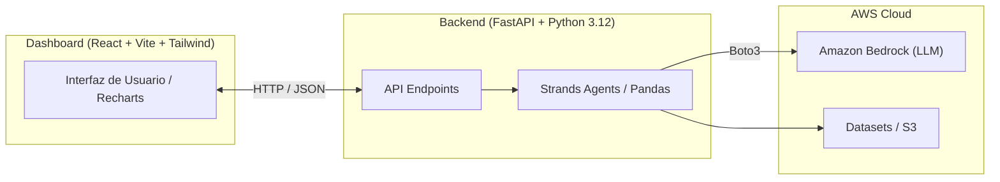

# Queryback - Hackathon UNAM

Sistema inteligente de analítica y consultas para el Hackathon UNAM / AWS.

---

## 🎯 Descripción del Proyecto
**Queryback** es una plataforma diseñada para procesar, consultar y visualizar grandes volúmenes de datos utilizando modelos de lenguaje e inteligencia artificial generativa con AWS Bedrock, ofreciendo un backend robusto en FastAPI y un dashboard interactivo moderno en React, TypeScript y Tailwind CSS.

### ¿Qué problema resolvemos?
Permitir a los usuarios y analistas explorar información clave de forma inmediata mediante consultas en lenguaje natural, extrayendo hallazgos accionables, métricas y correlaciones complejas sin requerir conocimientos técnicos avanzados de bases de datos.

---

## 🏗️ Arquitectura y Stack Tecnológico

El proyecto cumple estrictamente con el stack oficial del evento:

- **Backend:** Python 3.12.12, FastAPI 0.115.14, Uvicorn 0.34.3, Pydantic 2.11.7, Pandas 2.2.3, NumPy 2.1.3, Strands Agents 1.64.0, Boto3 1.44.0.
- **Frontend / Dashboard:** React 18.3.1, TypeScript 5.7.3, Vite 5.4.21, Tailwind CSS 3.4.19, Recharts 3.10.1.
- **Gestión de dependencias y entornos:** uv 0.11.19, Node.js 22.23.1, npm 10.9.8.



---

## 🚀 Cómo Ejecutar el Proyecto Localmente

### 1. Requisitos y Entorno
El entorno de este proyecto está completamente aislado dentro de la carpeta. No requiere instalar Python ni Node globales.

Para verificar que el entorno cumpla con el stack:
```powershell
.\.hackathon\setup.cmd --check
```

### 2. Configurar Variables de Entorno
Copia el archivo de ejemplo para las credenciales temporales de AWS:
```powershell
copy .env.example .env
```
Edita `.env` con tus llaves temporales del workshop.

### 3. Iniciar el Backend (FastAPI)
```powershell
.\.venv\Scripts\python.exe -m uvicorn backend.main:app --reload --port 8000
```
La API estará disponible en `http://localhost:8000` y la documentación interactiva en `http://localhost:8000/docs`.

### 4. Iniciar el Dashboard (React + Vite)
```powershell
.\.hackathon\.tools\node\npm.cmd --prefix dashboard run dev
```
El dashboard estará disponible en `http://localhost:5173`.

---

## 📦 Entrega del Proyecto

Para validar y generar el archivo `.zip` listo para evaluación y despliegue en AWS:
```powershell
.\.hackathon\setup.cmd --entregar
```
Este comando valida el stack, compila el dashboard, verifica que el backend responda y empaqueta todo en `entrega-Queryback-<fecha>.zip`.

---

## 👥 Equipo
- **Proyecto:** Queryback
- **Hackathon:** UNAM 2026
